<p align="center">
  <a href="https://dioramajs.dev">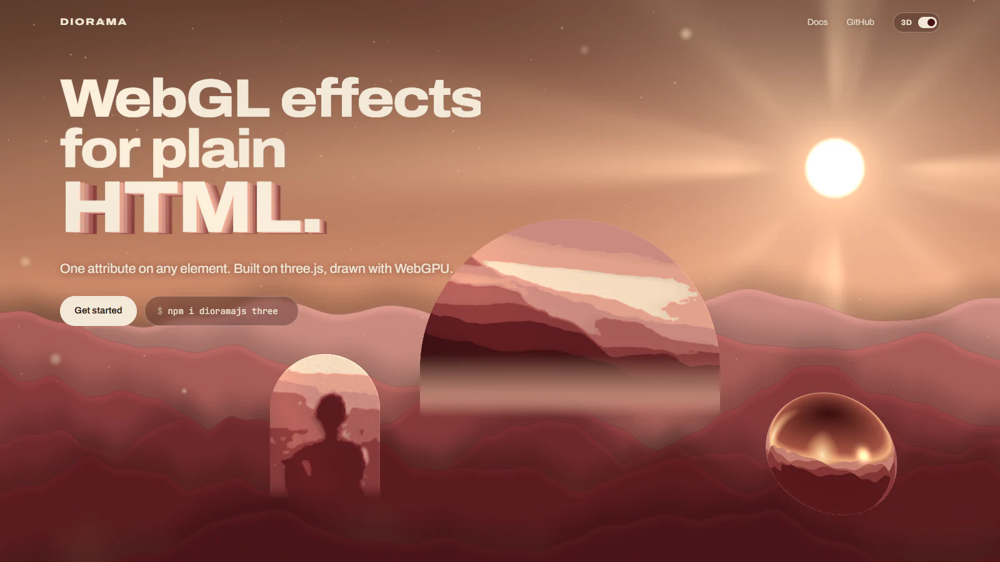</a>
</p>

<h1 align="center">Diorama</h1>

<p align="center">
  three.js effects for plain HTML. One attribute on any element.
</p>

<p align="center">
  <a href="https://www.npmjs.com/package/dioramajs"></a>
  <a href="https://bundlephobia.com/package/dioramajs"></a>
  
  
  <a href="LICENSE"></a>
</p>

<p align="center">
  <a href="https://dioramajs.dev/docs/start">Get started</a> &nbsp;·&nbsp;
  <a href="https://dioramajs.dev/docs/effects">100 effects</a> &nbsp;·&nbsp;
  <a href="https://dioramajs.dev/docs/learn/effect-in-10-minutes">Your own effect in 10 minutes</a> &nbsp;·&nbsp;
  <a href="https://dioramajs.dev/docs/api">API</a>
</p>

---

```html

```

That image is now a WebGL plane. Rings spread from the pointer, and the picture keeps its place in the layout while the page scrolls, reflows and resizes. Remove the attribute, or the element, and the GPU resources go with it.

Diorama treats the page as the scene. Layout stays in HTML and CSS, and the canvas follows it. three.js loads after the first paint and each effect loads when its element nears the viewport, so a page with no effects on screen pays for none of them. Frames are drawn only while something on screen changes.

## Effects

<table>
  <tr>
    <td width="33%"><a href="https://dioramajs.dev/docs/effects/fire"></a><br><code>fire</code></td>
    <td width="33%"><a href="https://dioramajs.dev/docs/effects/explode">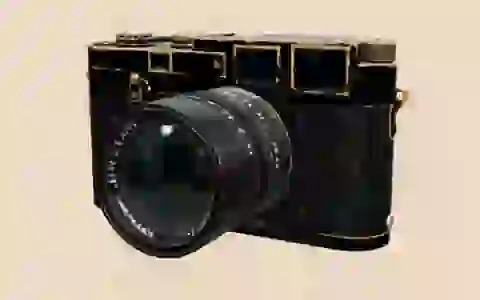</a><br><code>explode</code></td>
    <td width="33%"><a href="https://dioramajs.dev/docs/effects/ripple">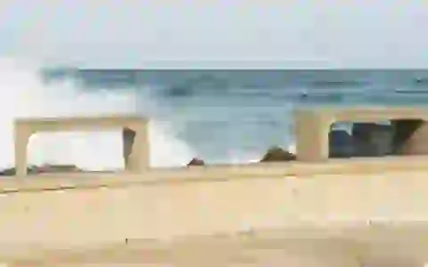</a><br><code>ripple</code></td>
  </tr>
  <tr>
    <td><a href="https://dioramajs.dev/docs/effects/globe">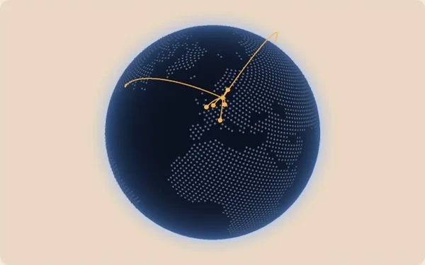</a><br><code>globe</code></td>
    <td><a href="https://dioramajs.dev/docs/effects/extrude">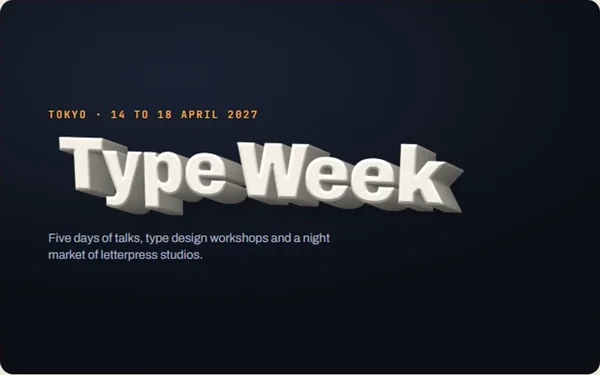</a><br><code>extrude</code></td>
    <td><a href="https://dioramajs.dev/docs/effects/coverflow">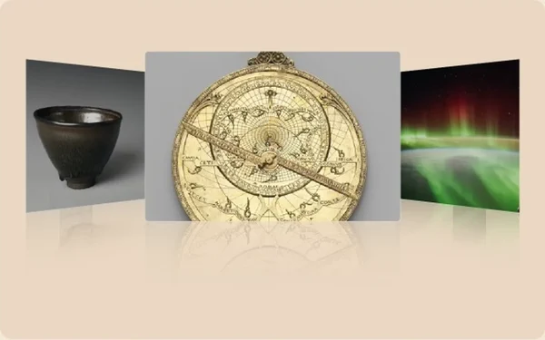</a><br><code>coverflow</code></td>
  </tr>
  <tr>
    <td><a href="https://dioramajs.dev/docs/effects/melt">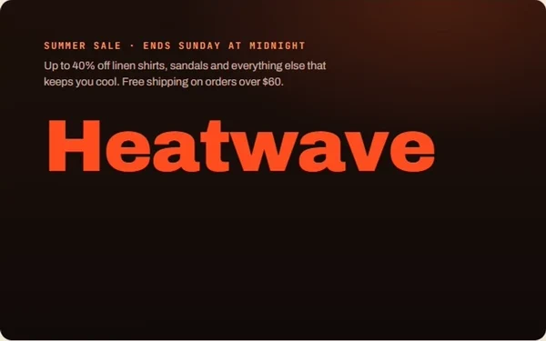</a><br><code>melt</code></td>
    <td><a href="https://dioramajs.dev/docs/effects/hotspots">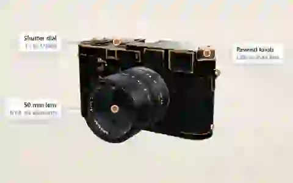</a><br><code>hotspots</code></td>
    <td><a href="https://dioramajs.dev/docs/effects/frost"></a><br><code>frost</code></td>
  </tr>
  <tr>
    <td><a href="https://dioramajs.dev/docs/effects/neon">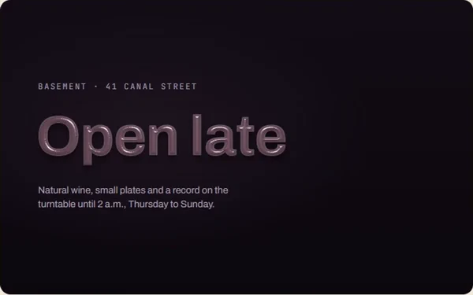</a><br><code>neon</code></td>
    <td><a href="https://dioramajs.dev/docs/effects/polaroids">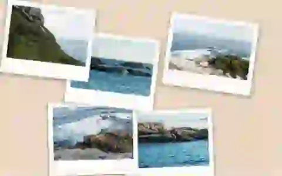</a><br><code>polaroids</code></td>
    <td><a href="https://dioramajs.dev/docs/effects/voxel">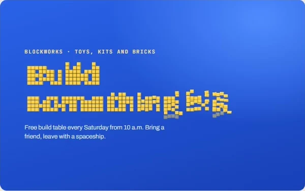</a><br><code>voxel</code></td>
  </tr>
</table>

Each one is an attribute away, and each takes its params from attributes too:

```html
<h1 data-dio="fire">Burn bright</h1>
<div data-dio="globe" data-dio-motion="flow"></div>

```

The full set, 100 effects with a live example and the params of each, is in the [gallery](https://dioramajs.dev/docs/effects):

| Group            | Effects                                                                                                                                                                                                                                                                                                                     |
| ---------------- | --------------------------------------------------------------------------------------------------------------------------------------------------------------------------------------------------------------------------------------------------------------------------------------------------------------------------- |
| Images and video | ambient, bend, carousel, chroma, compare, coverflow, curtain, expand, flare, flipbook, frost, gallery, glitch, horizontal, hover-preview, image, lightbox, liquid, panorama, parallax, pixelate, polaroids, reflection, reveal, ripple, scrub, sequence, spin, spotlight, stack, tilt, tone, video-hover, zoom, zoom-scroll |
| Text             | assemble, blinds, counter, dust, emboss, extrude, fire, hologram, inflate, keycaps, lens, magnet, marquee, melt, neon, orbit, physics, pins, prism, ribbon, rotator, scramble, shatter, shimmer, smoke, split-flap, text-glitch, text-reveal, tunnel, unfold, video-text, voxel, water, wave                                |
| 3D objects       | book, box, coin, device, explode, hotspots, label, model, vinyl                                                                                                                                                                                                                                                             |
| Backgrounds      | blobs, clouds, dots, gradient, grid, stars, waves                                                                                                                                                                                                                                                                           |
| Data             | chart, globe, graph, heatmap, map                                                                                                                                                                                                                                                                                           |
| Particles        | confetti, drops, emoji, snow, sparkles                                                                                                                                                                                                                                                                                      |
| Blocks           | beam, glow, shine                                                                                                                                                                                                                                                                                                           |
| Audio            | beat, visualizer                                                                                                                                                                                                                                                                                                            |

Elements with the same `data-dio-key` fly from one page to the next when the site navigates. Page covers hide the swap on any router: `start({ transitions: { cover: 'curtain' } })`, or `'ink'`, or `'pixel'`.

## Install

```bash
npm install @dioramajs/diorama three
```

Add the plugin. It turns every file in `src/effects/` into an effect and writes their types.

```ts
// vite.config.ts
import { diorama } from '@dioramajs/diorama/vite'

export default { plugins: [diorama()] }
```

Start the app once, in the module every page loads:

```ts
// src/main.ts
import { start } from '@dioramajs/diorama'

export const app = start()
```

Then put `data-dio` on an element. That's the whole setup.

<details>
<summary>Astro</summary>

```js
// astro.config.mjs
import diorama from '@dioramajs/diorama/astro'

export default { integrations: [diorama()] }
```

```astro
<!-- src/layouts/Layout.astro -->
<script>
  import { start } from '@dioramajs/diorama'
  start()
</script>
```

With `<ClientRouter />`, keyed elements fly between pages with no extra code.

</details>

<details>
<summary>Nuxt</summary>

```ts
// nuxt.config.ts
export default defineNuxtConfig({ modules: ['@dioramajs/diorama/nuxt'] })
```

```ts
// app/plugins/diorama.client.ts
import { start } from '@dioramajs/diorama'

export default defineNuxtPlugin(() => {
  start()
})
```

Effects go in `app/effects/`.

</details>

<details>
<summary>Next.js</summary>

```ts
// next.config.ts
import { withDiorama } from '@dioramajs/diorama/next'

export default withDiorama({})
```

```tsx
// app/diorama.tsx
'use client'
import { start } from '@dioramajs/diorama'
import { useEffect } from 'react'

export function Diorama() {
  useEffect(() => void start(), [])
  return null
}
```

Render `<Diorama />` once in the root layout. `withDiorama` writes the effect registry to `src/diorama.gen.ts`; commit it.

</details>

<details>
<summary>No build step (Webflow, Tilda, plain HTML)</summary>

```html
<script type="module" src="https://cdn.jsdelivr.net/npm/@dioramajs/diorama/dist/cdn/auto.js"></script>


```

The app starts on its own. Options go in `window.diorama` before the script tag, and GSAP from a CDN is picked up without code.

</details>

## Write your own

An effect is a file. Its name is the file name, its params come from the defaults, and the setup function shapes the picture with TSL nodes:

```ts
// src/effects/brighten.ts
import { effect } from '@dioramajs/diorama'

export default effect({ strength: 1 }, ({ surface, u }) => {
  surface.color((color) => color.mul(u.strength.add(1)))
})
```

```html

```

From code, names and params are type-checked against the file:

```ts
const brighten = app.attach('.hero', 'brighten', { strength: 2 })
brighten.params.strength = 3
```

The built-in effects are written the same way, with the same helpers. Copy one into your folder and change it:

```bash
npx dioramajs add spotlight
```

A GLSL fragment shader works too. With `@dioramajs/glsl`, a `.frag` file from Shadertoy or `ShaderMaterial` dropped into the folder is converted to TSL at build time, and its uniforms become params.

The tutorial [Your own effect in 10 minutes](https://dioramajs.dev/docs/learn/effect-in-10-minutes) builds a pointer-following lamp from scratch.

## Works with

- Vite, Astro, Nuxt and Next.js, with an integration for each, or a single script tag.
- GSAP and ScrollTrigger: tweens and the canvas share one ticker, and pins and scrubs drive effects.
- Lenis: smooth scroll stays in step with the canvas.
- Any component framework. Effects attach to DOM elements, so React, Vue or Svelte render the markup and Diorama follows it.

## Under the hood

- One canvas for the whole page, over it or behind it, kept in sync with layout and scroll.
- WebGPU where the browser has it and WebGL 2 everywhere else. Without either, the page stays plain HTML and every element keeps its content.
- `prefers-reduced-motion` is respected per effect, and `when: 'hover'` effects never load on touch screens.
- Text stays in the DOM, so search engines and screen readers read the page as written.
- Assets go through one cache with preload and progress, including glTF with Draco, Meshopt and KTX2.
- Quality adapts per device: a weak GPU or missed frames lower the pixel ratio and the cost of each effect, and the page stays the same.

## Packages

Most sites need only `@dioramajs/diorama`. It loads the rest on demand.

| Package                                          | Contents                                                                                      |
| ------------------------------------------------ | --------------------------------------------------------------------------------------------- |
| [`@dioramajs/diorama`](packages/diorama)         | `start()`, `effect()`, the Vite, Astro, Nuxt and Next.js integrations, the CDN build, the CLI |
| [`@dioramajs/core`](packages/core)               | App, plugins, signals, frame loop, stage, scroll and pointer                                  |
| [`@dioramajs/render`](packages/render)           | WebGPU renderer with the WebGL 2 fallback                                                     |
| [`@dioramajs/effects`](packages/effects)         | Effects on DOM elements, their runtime and the `kit` of helpers                               |
| [`@dioramajs/media`](packages/media)             | Image and video effects                                                                       |
| [`@dioramajs/text`](packages/text)               | Text effects                                                                                  |
| [`@dioramajs/model`](packages/model)             | 3D objects and glTF models                                                                    |
| [`@dioramajs/backgrounds`](packages/backgrounds) | Shader backgrounds                                                                            |
| [`@dioramajs/data`](packages/data)               | Charts, graphs, heatmaps and maps                                                             |
| [`@dioramajs/globe`](packages/globe)             | The globe                                                                                     |
| [`@dioramajs/particles`](packages/particles)     | Particle effects                                                                              |
| [`@dioramajs/blocks`](packages/blocks)           | Effects for cards and buttons                                                                 |
| [`@dioramajs/audio`](packages/audio)             | Audio-reactive effects                                                                        |
| [`@dioramajs/transitions`](packages/transitions) | Page transitions and keyed flights                                                            |
| [`@dioramajs/assets`](packages/assets)           | Loading, cache and preload                                                                    |
| [`@dioramajs/quality`](packages/quality)         | Adaptive quality                                                                              |
| [`@dioramajs/gsap`](packages/gsap)               | GSAP and ScrollTrigger                                                                        |
| [`@dioramajs/lenis`](packages/lenis)             | Lenis                                                                                         |
| [`@dioramajs/glsl`](packages/glsl)               | GLSL to TSL converter: Vite plugin, webpack loader and CLI                                    |

## Status

Diorama is at 0.x. The API is settling, and minor versions may still change it; every change is listed in the [changelog](CHANGELOG.md).

## Building from source

Node.js 22.12+ or 24+ and pnpm.

```bash
pnpm install
pnpm build
pnpm typecheck
```

## License

[MIT](LICENSE)
